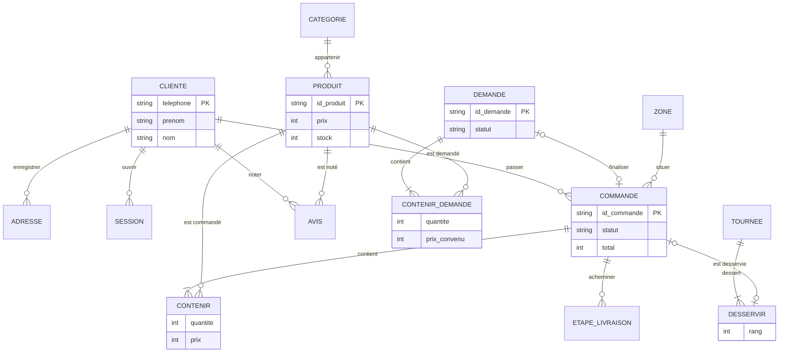

# Modélisation MERISE — Maefa Store

Démarche : règles de gestion → dictionnaire des données → **MCD** (modèle conceptuel) →
**MLD** (modèle logique relationnel) → **MPD** (schéma physique PostgreSQL : `server/db/schema.js` et sa migration `server/db/migrations/`,
et MySQL, `docs/base-de-donnees/maefa-mysql.sql`).

---

## 1. Règles de gestion

| N° | Règle |
|---|---|
| RG1 | Une cliente est identifiée par son numéro de téléphone (format international). |
| RG2 | Une cliente peut enregistrer plusieurs adresses de livraison ; une adresse appartient à une seule cliente. |
| RG3 | Un produit appartient à une seule catégorie ; une catégorie regroupe plusieurs produits. |
| RG4 | Une demande d'achat porte une référence unique DEM-XXXXX et contient au moins un produit. |
| RG5 | Pour chaque produit d'une demande, la gérante peut fixer un prix convenu différent du prix catalogue. |
| RG6 | Une commande ne peut être finalisée qu'à partir d'une demande confirmée « disponible » ; une demande donne au plus une commande. |
| RG7 | Une commande contient au moins un produit, avec sa quantité, sa couleur, sa taille et son prix. |
| RG8 | Une commande est livrée en un point (coordonnées GPS, repère) situé dans une zone de livraison ; les frais dépendent de la zone et ne sont jamais nuls. |
| RG9 | Une commande peut être livrée en une ou plusieurs étapes (relais), chacune confiée à un livreur. |
| RG10 | Une tournée dessert plusieurs commandes dans un ordre calculé ; une commande appartient au plus à une tournée à la fois. |
| RG11 | Une cliente peut laisser un avis par produit acheté. |
| RG12 | Une session de connexion appartient à une cliente ; seule l'empreinte du jeton est gardée. |
| RG13 | Place de marché : un compte peut ouvrir au plus une boutique (VENDEUR), visible seulement après validation par la gérante. |
| RG14 | Une annonce appartient à un seul vendeur ; elle n'est visible qu'une fois vérifiée (« publiée ») et tant que la boutique est validée. |
| RG15 | Une commande de la place de marché concerne un seul vendeur : un panier avec plusieurs vendeurs donne une commande par vendeur. |
| RG16 | Le prix, le stock et les frais viennent toujours du serveur ; la livraison dépend de la distance vendeur → acheteur (prise en charge + prix au km, minimum et maximum). |
| RG18 | Un livreur (compte validé par la gérante) prend au plus une course à la fois ; une course regroupe 1 à 4 commandes (express : 1). |
| RG19 | Moitié-moitié : une commande ne rejoint une course que si aucun membre ne paie plus et que le détour reste raisonnable ; chacun paie au plus le prix de sa course seule. |
| RG20 | Livraison par livreur (méthode A) : le livreur encaisse l'acheteur, envoie au vendeur le prix des articles moins sa commission, garde sa part moins sa commission, et doit le reste à la plateforme. |
| RG21 | Un vendeur a la formule Découverte (gratuite, articles limités) ou Pro (abonnement mensuel, commission réduite) ; chaque abonnement payé est enregistré. |
| RG22 | Seule l'acheteuse d'une commande livrée peut laisser un avis (vendeur, livreur), une fois, dans les 30 jours ; la note d'un vendeur est la moyenne de ses avis non masqués. |
| RG23 | Un problème (non conforme, abîmé, incomplet) se signale sous 72 h après la livraison ; « non reçu » tant que la commande n'est pas livrée ; la gérante le résout ou le rejette avec une explication. |
| RG24 | Un vendeur remet ses colis au livreur de trois façons : à son adresse (fixe), là où il se trouve quand le colis est prêt (sans adresse fixe : il donne sa position à chaque commande), ou dans un point relais actif choisi par lui. L'acheteur ne voit jamais la position, le point relais ni le numéro du vendeur ; seul le livreur de la course voit le point de remise. Le prix de livraison part de la position du vendeur arrondie (~500 m). |
| RG25 | Chaque commande livrée par un livreur a deux codes de remise à 4 chiffres : celui du vendeur (ou du point relais) valide l'enlèvement et le retour, celui de l'acheteur valide le dépôt. 5 codes faux bloquent le colis jusqu'à la gérante. |
| RG26 | Un livreur ne prend plus de course quand l'argent qu'il garde (commissions dues + parts des vendeurs non reçues) atteint son plafond ; il ne livre jamais une commande dont il est l'acheteur ou le vendeur. |
| RG27 | Une livraison ratée (absent, refus) renvoie le colis au vendeur ; à 2 livraisons ratées non pardonnées, l'acheteur ne peut plus commander ; 5 commandes en cours au plus tant qu'il n'a jamais été livré, 15 ensuite. |
| RG28 | Tant qu'une boutique (non « de confiance ») a moins de 3 ventes livrées, une commande ne dépasse pas le montant fixé par la gérante ; nul ne commande dans sa propre boutique. |
| RG29 | Chaque mouvement d'argent est ajouté au registre (jamais modifié) avec l'empreinte scellée de la ligne précédente. |
| RG31 | Le vendeur choisit pour chaque article : prix affiché, ou prix caché « à négocier » (le public voit une classe de prix). Un article à négocier ne se commande qu'au prix convenu. |
| RG32 | Une discussion relie un acheteur et un vendeur au sujet d'un article. Une offre acceptée devient le prix convenu : 48 h, une commande d'un article. Pas de numéro, lien ni e-mail dans les messages. |
| RG33 | L'annuaire des boutiques et le fil de découverte ne montrent aucun prix et aucun tri par prix : les vendeurs ne sont pas mis en concurrence ; les prix se voient dans chaque boutique. |
| RG34 | Chaque boutique d'abonné a sa vitrine (logo, bannière, couleur), un lien court et un QR code. |
| RG35 | Un appel par internet relie les deux personnes d'une discussion, sans échange de numéro ; sa durée, ou le fait qu'il soit manqué ou refusé, est noté dans la discussion. |
| RG36 | Une boutique ouverte avec le lien de parrainage d'une autre est rattachée à sa marraine ; à sa première vente livrée (dont l'acheteur n'est pas la marraine), la marraine reçoit 1 mois de formule Pro, une seule fois, noté au registre. |
| RG37 | Une cliente connectée peut suivre une boutique (pas la sienne) ; à la mise en ligne d'un article, les abonnées sont prévenues au plus une fois par 24 h par boutique. |
| RG38 | Une mise « À la une » payée (1 à 12 semaines) place la boutique en tête de l'annuaire et la favorise dans le fil ; chaque achat est enregistré et noté au registre. |
| RG39 | Seule une boutique validée peut faire un live, un à la fois ; ses abonnées sont prévenues au début (au plus une fois toutes les 3 h). |
| RG40 | Un prix live est facultatif, entre 100 F et le prix de l'article ; il s'applique à la commande pendant le live et 15 minutes après. |
| RG41 | Commenter un live demande d'être connectée (prénom seulement) ; pas de numéro, lien ni réseau social ; la vendeuse peut masquer une personne ; la gérante peut arrêter un live. |
| RG42 | Chaque vendeuse a son tableau de bord (7, 30, 90 jours ou 12 mois) calculé sur ses seules commandes : uniquement des chiffres, jamais le numéro ni le nom d'une cliente ; l'export pour la comptabilité ne contient pas non plus de données de clientes. La gérante peut l'ouvrir. |
| RG43 | Un live se programme de 5 minutes à 14 jours à l'avance (un à la fois par boutique) ; les clientes qui demandent un rappel sont prévenues 15 minutes avant et au début ; un live programmé non tenu est oublié 2 h après l'heure prévue. |
| RG44 | Une offre flash porte sur un article du live : prix plus bas que l'article, durée de 2, 5, 10 ou 15 minutes, quantité facultative (1 à 500) ; le prix s'applique à la commande pendant le compte à rebours (et 3 minutes après) tant qu'il reste des pièces ; chaque commande décompte les pièces. |
| RG45 | Le bandeau d'annonce d'un live fait 80 caractères au plus, sans numéro, lien ni réseau social. |
| RG30 | Un arrêt fait sans réseau est gardé sur le téléphone du livreur et envoyé au retour du réseau avec son heure réelle ; le serveur vérifie le code à la réception, comme pour un arrêt en direct. |
| RG17 | Sur chaque commande livrée, la plateforme perçoit une commission vendeur (% de la vente) et des frais de service acheteur ; le vendeur les règle, ses paiements sont enregistrés par la gérante. |

## 2. Dictionnaire des données (extrait)

| Code | Signification | Type | Taille | Entité |
|---|---|---|---|---|
| telephone | Numéro de la cliente (+221…) | AN | 20 | CLIENTE |
| prenom, nom | Identité | A | 60 | CLIENTE |
| empreinte_code | Code personnel chiffré (scrypt) | AN | 128 | CLIENTE |
| id_adresse | Identifiant d'adresse | AN | 40 | ADRESSE |
| libelle_adresse | « Maison », « Bureau »… | A | 40 | ADRESSE |
| latitude, longitude | Coordonnées GPS | N | 9,6 | ADRESSE, COMMANDE |
| repere | « À côté de la mosquée… » | AN | 160 | ADRESSE, COMMANDE |
| id_produit | Référence produit (MAE-101) | AN | 40 | PRODUIT |
| prix | Prix de vente en FCFA (confidentiel) | N | 10 | PRODUIT |
| stock | Quantité disponible | N | 5 | PRODUIT |
| delai_sur_commande | Délai en jours si épuisé | N | 3 | PRODUIT |
| id_demande | Référence DEM-XXXXX | AN | 9 | DEMANDE |
| statut_demande | nouvelle, disponible, indisponible, commandée | A | 15 | DEMANDE |
| prix_convenu | Prix fixé après marchandage | N | 10 | CONTENIR_DEMANDE |
| id_commande | Référence MAE-… | AN | 20 | COMMANDE |
| statut_commande | en attente, confirmée, en préparation, expédiée, livrée, annulée | A | 15 | COMMANDE |
| mode_paiement | wave, orange_money, cash | A | 15 | COMMANDE |
| total | Montant total en FCFA | N | 10 | COMMANDE |
| nom_zone, frais_zone | Zone de livraison et frais | A / N | 60 / 6 | ZONE |
| id_tournee, rang | Tournée et ordre de passage | AN / N | 20 / 3 | TOURNEE, DESSERVIR |
| mode_remise | fixe, variable, relais | A | 10 | VENDEUR, COMMANDE_MARCHE |
| logo, banniere, couleur | Vitrine de la boutique en ligne | AN | 60 / 60 / 12 | VENDEUR |
| id_relais | Référence R-XXXXX | AN | 7 | POINT_RELAIS |
| horaires | « 9 h – 20 h » | AN | 80 | POINT_RELAIS |
| code_enlevement, code_depot | Codes de remise à 4 chiffres | N | 4 | COMMANDE_MARCHE |
| motif_echec | absent, refus | A | 10 | COMMANDE_MARCHE |
| plafond_argent | Argent qu'un livreur peut garder | N | 9 | LIVREUR |
| mode_prix | affiche, negocier | A | 8 | ANNONCE |
| montant_offre, statut_offre | Offre de prix et sa réponse (en_attente, acceptee, refusee, remplacee) | N / A | 9 / 10 | MESSAGE |
| prix_convenu, valable_jusqu_a | Accord de la discussion | N / D | 9 | DISCUSSION |
| num_operation, empreinte | Ligne du registre et son empreinte HMAC | N / AN | 9 / 64 | OPERATION |

## 3. MCD — Modèle conceptuel des données

### Entités
- **CLIENTE** (<u>telephone</u>, prenom, nom, empreinte_code, date_creation)
- **ADRESSE** (<u>id_adresse</u>, libelle, icone, latitude, longitude, repere, precision)
- **CATEGORIE** (<u>id_categorie</u>, nom)
- **PRODUIT** (<u>id_produit</u>, nom, slug, prix, ancien_prix, stock, delai_sur_commande, description)
- **DEMANDE** (<u>id_demande</u>, statut, date, note, total)
- **COMMANDE** (<u>id_commande</u>, statut, mode_paiement, statut_paiement, sous_total, reduction, frais_livraison, total, latitude, longitude, repere, date)
- **ZONE** (<u>nom_zone</u>, frais, delai)
- **ETAPE_LIVRAISON** (<u>id_etape</u>, nom_livreur, telephone_livreur, statut, position)
- **TOURNEE** (<u>id_tournee</u>, jeton, date, distance)
- **AVIS** (<u>id_avis</u>, note, commentaire, date)
- **SESSION** (<u>empreinte_jeton</u>, date)
- **VENDEUR** (<u>id_vendeur</u>, nom_boutique, slug, rayon, quartier, latitude, longitude, mode_remise, logo, banniere, couleur, statut, de_confiance, date_creation)
- **ANNONCE** (<u>id_annonce</u>, titre, description, prix, mode_prix, rayon, etat, photos, stock, choix, statut, raison_refus, vues, date)
- **COMMANDE_MARCHE** (<u>id_commande_marche</u>, statut, sous_total, frais_livraison, distance_km, frais_service, commission_vendeur, total, mode_paiement, latitude, longitude, repere, mode_remise, latitude_remise, longitude_remise, repere_remise, code_enlevement, code_depot, essais_code, motif_echec, date)
- **REGLEMENT** (<u>id_reglement</u>, montant, note, date)
- **LIVREUR** (<u>id_livreur</u>, nom, telephone, vehicule, quartier, statut, disponible, latitude, longitude, plafond_argent, date_creation)
- **COURSE** (<u>id_course</u>, mode, statut, heure_depart, distance_km, prix_total, date)
- **ABONNEMENT** (<u>id_abonnement</u>, mois, montant, date, fin)
- **AVIS_MARCHE** (<u>#id_commande_marche</u>, note_vendeur, texte, note_livreur, masque, date) — 0 ou 1 par commande
- **SIGNALEMENT** (<u>#id_commande_marche</u>, type, texte, statut, solution, date, date_resolution) — 0 ou 1 en cours par commande
- **POINT_RELAIS** (<u>id_relais</u>, nom, quartier, horaires, telephone, latitude, longitude, adresse, repere, actif, date_creation)
- **DISCUSSION** (<u>id_discussion</u>, prenom_acheteur, prix_convenu, valable_jusqu_a, date)
- **MESSAGE** (<u>id_message</u>, auteur, texte, montant_offre, statut_offre, date)
- **OPERATION** (<u>num_operation</u>, date, type, donnees, empreinte_precedente, empreinte) — registre infalsifiable

### Associations et cardinalités

| Association | Entité A (card.) | Entité B (card.) | Propriétés |
|---|---|---|---|
| ENREGISTRER | CLIENTE (0,n) | ADRESSE (1,1) | — |
| APPARTENIR | PRODUIT (1,1) | CATEGORIE (0,n) | — |
| CONTENIR_DEMANDE | DEMANDE (1,n) | PRODUIT (0,n) | quantite, couleur, taille, prix_convenu, prix_catalogue |
| FINALISER | COMMANDE (0,1) | DEMANDE (0,1) | — |
| PASSER | CLIENTE (0,n) | COMMANDE (1,1) | — |
| CONTENIR | COMMANDE (1,n) | PRODUIT (0,n) | quantite, couleur, taille, prix |
| SITUER | COMMANDE (1,1) | ZONE (0,n) | — |
| ACHEMINER | COMMANDE (0,n) | ETAPE_LIVRAISON (1,1) | ordre |
| DESSERVIR | TOURNEE (1,n) | COMMANDE (0,1) | rang |
| NOTER | CLIENTE (0,n) / PRODUIT (0,n) | AVIS (1,1) | — |
| OUVRIR | CLIENTE (0,n) | SESSION (1,1) | — |
| TENIR | CLIENTE (0,1) | VENDEUR (1,1) | — |
| PUBLIER | VENDEUR (0,n) | ANNONCE (1,1) | — |
| ACHETER | CLIENTE (0,n) | COMMANDE_MARCHE (1,1) | — |
| RECEVOIR | VENDEUR (0,n) | COMMANDE_MARCHE (1,1) | — |
| COMPRENDRE | COMMANDE_MARCHE (1,n) | ANNONCE (0,n) | quantite, choix, prix |
| REGLER | VENDEUR (0,n) | REGLEMENT (1,1) | — |
| REGROUPER | COURSE (1,n) | COMMANDE_MARCHE (0,1) | part_livraison, ordre_enlevement, ordre_depot |
| EFFECTUER | LIVREUR (0,n) | COURSE (0,1) | date_acceptation |
| VERSER | LIVREUR (0,n) | REGLEMENT (1,1) | — |
| SOUSCRIRE | VENDEUR (0,n) | ABONNEMENT (1,1) | — |
| PORTER_SUR | DISCUSSION (1,1) | ANNONCE (0,n) | — |
| ECHANGER | CLIENTE (0,n) / VENDEUR (0,n) | DISCUSSION (1,1) | — |
| CONTENIR_MSG | DISCUSSION (1,n) | MESSAGE (1,1) | — |
| DEPOSER | VENDEUR (0,1) | POINT_RELAIS (0,n) | — (seulement en mode « relais ») |
| PASSER_PAR | COMMANDE_MARCHE (0,1) | POINT_RELAIS (0,n) | — (relais retenu à la commande) |

### Schéma

## 4. MLD — Modèle logique relationnel

Règles de passage : une entité devient une table ; une association (1,1)–(0,n) devient une clé
étrangère du côté (1,1) ; une association (x,n)–(x,n) devient une table dont la clé est le couple
des clés ; ses propriétés deviennent des colonnes.

- **customers** (<u>phone</u>, first_name, last_name, pin_hash, wishlist, created_at, updated_at)
- **customer_addresses** (<u>id</u>, #customer_phone, name, icon, lat, lng, label, landmark, accuracy)
- **sessions** (<u>token_hash</u>, #customer_phone, created_at)
- **products** (<u>id</u>, slug, name, category, price, old_price, stock, preorder_days, data)
- **purchase_requests** (<u>id</u>, status, created_at, total, note, #order_id, customer, history)
- **request_items** (<u>id</u>, #request_id, product_id, name, price, catalog_price, quantity, size, color)
- **orders** (<u>id</u>, status, payment_method, payment_status, subtotal, discount, delivery_fee, gift_fee, total, zone, #request_id, customer_phone, created_at, data)
- **order_items** (<u>id</u>, #order_id, product_id, name, price, quantity, size, color)
- **deliveries** (<u>#order_id</u>, data)
- **tours** (<u>id</u>, token, created_at, data)
- **account_orders** (<u>#customer_phone, order_id</u>, data)
- **mp_sellers** (<u>id</u>, owner_phone, slug, status, created_at, data) — VENDEUR et ses RÈGLEMENTS
- **mp_listings** (<u>id</u>, #seller_id, status, price, created_at, data) — ANNONCE
- **mp_orders** (<u>id</u>, #seller_id, buyer_phone, status, total, created_at, data) — COMMANDE_MARCHE et ses lignes
- **mp_drivers** (<u>id</u>, owner_phone, status, created_at, data) — LIVREUR et ses versements
- **mp_trips** (<u>id</u>, mode, status, #driver_id, created_at, data) — COURSE, ses arrêts et les parts de chacun
- **mp_chats** (<u>id</u>, #listing_id, #seller_id, buyer_phone, updated_at, data) — DISCUSSION et ses MESSAGES
- **mp_ledger** (<u>seq</u>, at, type, hash, data) — OPERATION (registre : lignes ajoutées, jamais modifiées)
- **app_settings**(clé `mpRelays`) — POINT_RELAIS (peu nombreux : un document JSON) ; `mp_sellers.data.relayId` et
  `mp_orders.data.delivery.relay` portent les associations DEPOSER et PASSER_PAR

`#` = clé étrangère ; <u>souligné</u> = clé primaire. Les colonnes `data` (JSONB) gardent les détails
variables (couleurs, photos, étapes de livraison) sans multiplier les tables.

## 5. MPD

Le schéma physique PostgreSQL est décrit avec l'ORM Drizzle dans `server/db/schema.js` ; la migration générée (`server/db/migrations/0000_schema_initial.sql`) crée les tables, clés
primaires et étrangères, contraintes CHECK, index). Un équivalent MySQL complet est fourni dans
`docs/base-de-donnees/maefa-mysql.sql` avec son diagramme EER.
